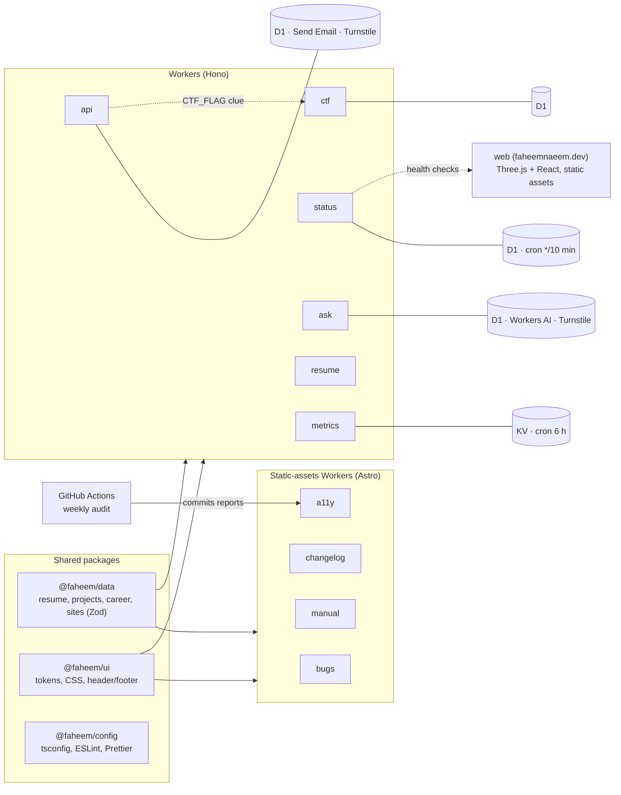

# Faheem Naeem — Portfolio

A personal portfolio for Faheem Naeem, a Calgary-based software developer with experience in full-stack applications, cloud platforms and AI-powered product features. The site preserves the original interactive 3D desktop experience and now presents Faheem’s resume-backed profile, experience, selected work, skills, education and contact links.

## Repository layout

This is a pnpm + Turborepo monorepo. Each subdomain of faheemnaeem.dev is its own app, and every app
runs on the Cloudflare Workers **Free** plan ($0): no paid APIs, no API keys for AI.

### Architecture



`@faheem/config` is used by every app (lint and TypeScript settings). `apps/web` does not import the
workspace packages; it stays exactly as the live 3D site.

### Subdomains

| Subdomain | App | Type | Pitch | Status |
| --- | --- | --- | --- | --- |
| [faheemnaeem.dev](https://faheemnaeem.dev) | `apps/web` | Static assets | Interactive 3D desktop portfolio | Live |
| resume.faheemnaeem.dev | `apps/resume` | Worker | A curl-able terminal resume | Built, not yet deployed |
| api.faheemnaeem.dev | `apps/api` | Worker + D1 + Email | Public JSON API (OpenAPI docs) for resume data, plus interview requests | Built, not yet deployed |
| status.faheemnaeem.dev | `apps/status` | Worker + D1 + cron | A status page for the sites and for me | Built, not yet deployed |
| bugs.faheemnaeem.dev | `apps/bugs` | Static assets (Astro) | Memorable bugs, how they were found and fixed | Built, not yet deployed |
| changelog.faheemnaeem.dev | `apps/changelog` | Static assets (Astro) | My career as semantic-versioned release notes | Built, not yet deployed |
| manual.faheemnaeem.dev | `apps/manual` | Static assets (Astro) | How to work with me | Built, not yet deployed |
| a11y.faheemnaeem.dev | `apps/a11y` | Static assets + GitHub Actions | Live accessibility reports for every site | Built, not yet deployed |
| ask.faheemnaeem.dev | `apps/ask` | Worker + Workers AI + D1 | Ask questions about my experience, answered by AI | Built, not yet deployed |
| ctf.faheemnaeem.dev | `apps/ctf` | Worker + D1 | A small capture-the-flag puzzle across the network | Built, not yet deployed |
| metrics.faheemnaeem.dev | `apps/metrics` | Worker + KV + cron | Public coding metrics dashboard | Built, not yet deployed |

| Path              | What it is                                                                             |
| ----------------- | -------------------------------------------------------------------------------------- |
| `apps/*`          | One app per subdomain (see table above)                                                |
| `packages/config` | Shared TypeScript, ESLint and Prettier config                                          |
| `packages/data`   | Single source of truth for resume, projects, career, sites and content (Zod-validated) |
| `packages/ui`     | Shared design tokens, base CSS and HTML layout (header/footer)                         |

Docs: [DEPLOYMENT.md](./DEPLOYMENT.md) (step-by-step Cloudflare setup and smoke tests),
[MIGRATION.md](./MIGRATION.md) (main-site move into the monorepo),
[docs/SECURITY_REVIEW.md](./docs/SECURITY_REVIEW.md).

## Run locally

```sh
pnpm install
pnpm --filter web dev
```

## Production build

```sh
pnpm turbo run build --filter=web   # main site only (what `pnpm build` runs), output: apps/web/public
pnpm build:all                      # every app
pnpm turbo run build test typecheck lint   # full check of the whole monorepo
```

The portfolio displayed on the 3D computer monitor is served from `apps/web/static/faheem-portfolio.html` and copied into the production build.

## Contact

- Email: [faheem.naeem017@gmail.com](mailto:faheem.naeem017@gmail.com)
- LinkedIn: [linkedin.com/in/faheem-naeem](https://www.linkedin.com/in/faheem-naeem/)
- Location: Calgary, Alberta, Canada
